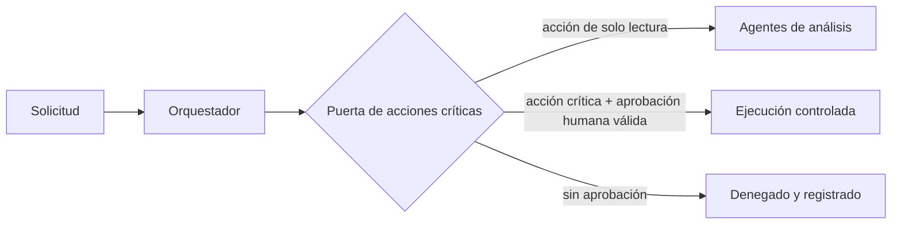

# Arquitectura

Nexus Velocity IA es una plataforma propia de **orquestación multiagente** para automatizar trabajo de negocio con control humano. Este documento describe el diseño. No contiene código interno.

## Componentes
| Capa | Función |
|---|---|
| Orquestador | Recibe una solicitud, la clasifica y decide a qué agente enrutarla |
| 11 agentes | Búsqueda, análisis, redacción, validación, legal, marketing, ventas, desarrollo, seguridad, auditoría y orquestador. Cada uno tiene su política |
| Puerta de acciones críticas | Componente determinista, **sin LLM**, que autoriza o deniega acciones con efecto externo |
| Automatización | n8n en contenedores Docker para flujos y webhooks |
| Plataforma | Servicio en Bun/TypeScript con API interna autenticada |
| Modelos | Endpoint local con Ollama |
| Memoria | Almacén local en SQLite, con enmascarado de datos personales (desactivada por defecto) |

## Flujo

## Acciones críticas
Publicar contenido, enviar correos, mensajes o llamadas, activar pagos, cambiar infraestructura, desplegar código, gastar créditos externos, borrar datos y activar agentes o flujos. **Toda acción desconocida se deniega.**

## Aprobación humana
Una aprobación es un objeto firmado con HMAC-SHA256, de **un solo uso**, con **caducidad** corta y emitido por una persona distinta de quien solicita. Un agente nunca puede aprobar.

## Activación por fases
Los agentes se activan de forma gradual. Hoy la plataforma opera en **modo controlado**: la delegación a agentes y las integraciones externas permanecen desactivadas hasta aprobación explícita.
